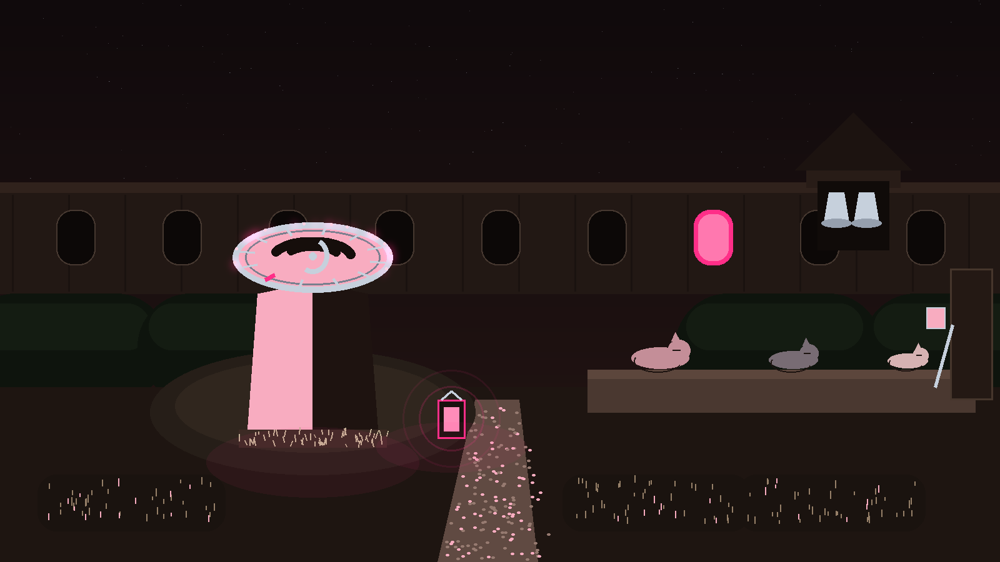
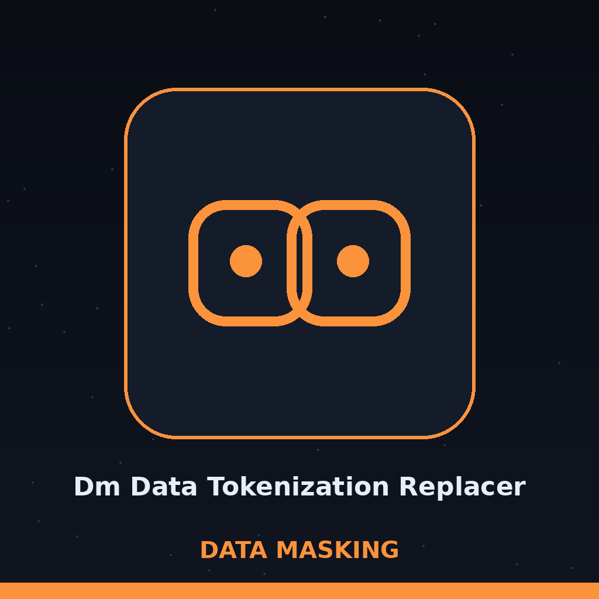
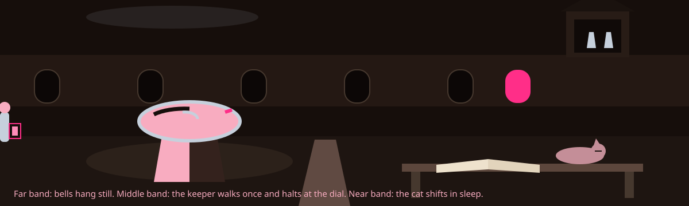

# dm-data-tokenization-replacer

Night watch log entry, first hour: the name above is set in Caramel in pink, with a small moon sketch at the left of this title block and the moon dial drawn small beside this first heading only.

# dm-data-tokenization-replacer
Replaces sensitive data with unique, reversible tokens. Supports multiple tokenization methods (e.g., UUIDs, sequential IDs) and allows for the management of a token-to-value mapping for later de-tokenization. Takes CSV file as input. - Focused on Tools designed to generate or mask sensitive data with realistic-looking but meaningless values

## Install
`git clone https://github.com/ShadowGuard-AI/dm-data-tokenization-replacer`

> Night watch log entry, corrected in this wave: the clone line formerly named a predecessor organisation; it now names ShadowGuard-AI.

## Usage
`python3 main.py INPUT_FILE OUTPUT_FILE --tokenize_columns COL [COL ...] [options]`

## Parameters
- `input_file`: The input CSV file. Required.
- `output_file`: The output CSV file with tokenized data. Required.
- `-h`: Show help message and exit
- `--tokenize_columns`: A list of column names to tokenize, one or more. Required.
- `--token_method`: The tokenization method to use. Choices: uuid, sequential. Defaults to uuid.
- `--token_map_file`: The file to store the token-to-value mapping (CSV). Defaults to token_map.csv.
- `--detokenize`: Detokenize the data using the token map file.

> Night watch log entry: tokens are unique and reversible.

> Night watch log entry: a token to value mapping is kept for later de-tokenization.

> Night watch log entry, corrected in this wave: the method control formerly carried no description; it now carries its uuid and sequential choices and uuid default.

> Night watch log entry, corrected in this wave: the map file control formerly carried no description; it now carries its CSV purpose and token_map.csv default.

## License
This project is released under the license in the [LICENSE](LICENSE) file. See LICENSE for details.

## The Mapping Is Kept

The main button of this re-skin reads Tokenize the Columns. Its columns field label reads Columns to Tokenize. Its mapping heading reads The Mapping Is Kept. Its return heading reads Detokenize with the Map.

## Detokenize with the Map

An output control is now named in the parameter list: output_file, the output CSV file, required. No refusal or exit behaviour for any case is stated in this README. It ends with the moon dial framed in the final lit window, the watch discharged, and the garden dark and quiet.
